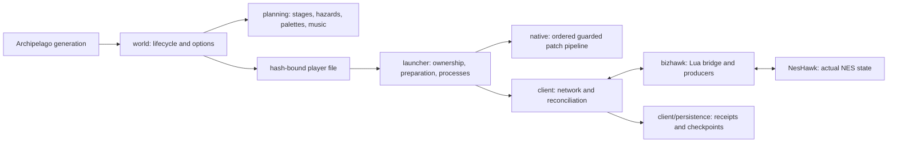

<!-- SPDX-License-Identifier: MPL-2.0 -->
# How SMB3X is organized

Start with `src/smb3x/world/registration.py`. `SMB3World` explicitly names its
Archipelago lifecycle methods. The same directory contains options, regions,
rules, item pools, placement and output. It does not configure earlier world
classes or wrap a chain of milestone implementations.

`shared` contains stable IDs, identity/registry contracts, serialization and
filesystem limits. It imports neither world registration nor the AP client.
`planning` produces deterministic plans before any ROM is supplied. `native/pipeline.py`
applies named stages in the established order to a verified original ROM.
`native/patches` contains distinct guarded operations; `native/music` contains
audio installation and compiler support. No production assembler swaps a global
project root or subprocess function.

`launcher/player.py:main` validates the container, selects its cached runtime,
owns the session lock, prepares once, then calls `launcher/emulator.py:play`.
Preferences, associations, resource verification and artifact paths are separate.
`client/network.py:SMB3Context` owns AP identity and indexed replay.
`client/service.py:watcher` orders polling, acknowledgement, checkpoint coordination
and publication. `transport.py` owns sequenced exchange; `native_session.py` validates
native state. Effects and DeathLink remain distinct state machines.

`client/persistence` separates receipts, snapshots, world journals, checkpoint
generations, authority coordination, atomic writes and locks. `bizhawk/bridge.lua`
composes the current location detector, mailbox, delivery, checkpoints, effects,
DeathLink and presentation. `notifications.lua` owns the queue;
`presentation_body.lua` draws the panel. There are no historical monitor/mailbox
wrappers replacing their methods after loading.

## Package ownership

`packaging/apworld_bootstrap.py` verifies one immutable resource set, then explicitly
registers `world.registration`. The resource package's `__init__.py` is minimal:
importing player/shared code does not register another AP world.
`launcher/runtime.py` loads a package named by its full resource hash; generic
global `client` or `tools` modules cannot redirect it. The tiny `runtime_m28.py`
entry remains solely for old dispatch contracts. The root development `smb3x`
package points to the actual implementation in `src/smb3x`.

Old player files choose their exact historical cache before current preparation.
They do not acquire new journal semantics. Source paths/resource hashes can change
in a new release; stable AP IDs, native addresses and serialized meanings do not.
Read CODEBASE_GUIDE.md next. Native State mocks and real emulator evidence are
different verification levels.

## Reading safety boundaries

An observed physical clear, a durable saved clear and a server-confirmed check are
different facts. Likewise, a pending indexed receipt is not an applied native grant.
The service loop and coordinator keep these boundaries explicit. Formatting and local
names can change; serialized keys, short-circuit validation order, awaits and filesystem
publication order must not change as a side effect of a readability edit.

`network.validate_connected_identity` admits only slot release `m27-1`. Later audio,
interface, effects and music validations are mandatory, without obsolete release
alternatives. Historical player files select their resource-bound runtime in the
launcher before reaching the current client's preparation/connection path.

M35 emulator/version and State boundaries are documented in
[emulator qualification](docs/emulator-qualification.md). Original project source
notices use MPL-2.0; see LICENSE-SCOPE.json and NOTICE.md for exclusions.
